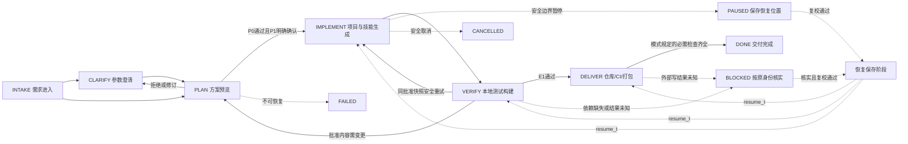

# 当前产品业务主线

这是当前项目的方案阅读图。状态和合法事件以[冻结基线](00-invariants/INVARIANTS.md#状态与事件基线)为准；图展示主线和主要反馈，不替代完整转移表或运行证据。

暂停和取消适用于不变量表列出的非终止阶段，图未画出所有连线。终止任务的重做建立关联新Run，不沿用旧批准复活；只读与核实既有副作用不改变终止事实。

| 阶段 | 谁负责 | 产出 | 人的介入 | 失败/反馈 |
| --- | --- | --- | --- | --- |
| 需求进入/澄清 | 编排登记，Agent提建议，用户补充 | Run身份、目标/参数、缺项与默认建议 | 缺少项目名、能力取舍或明确范围时补充 | 非法/歧义保留当前需求，不写项目 |
| 方案预览 | Agent建议、模板生成候选、治理校验、对话呈现 | 提案、文件差异、影响、来源版本、目标与检查 | 确认具体版本和操作范围；拒绝或再改改 | 规则失败blocked提案；source变更关闭旧确认 |
| 实施 | 编排调度登记Skill与模板执行器 | 批准快照对应文件、manifest与步骤证据 | 范围内执行不逐文件询问；新范围需新提案 | 部分结果核实；未知不盲重放；安全边界暂停 |
| 本地验证 | 独立验证契约 | required_checks、真实test/build、安全和来源报告 | 通常自动；不可恢复说明原因 | 同快照安全重试；内容修复先重新预览批准 |
| 交付 | 集成执行器、验证契约、编排 | 精确仓库/commit/pipeline证据或本地包，最终报告 | 配置缺失时补环境或显式改交付选择 | 缺runner/权限阻塞；原外部调用身份核实 |
| 完成 | 编排消费固定完整证据 | 成果引用、模式、验证边界与完整历史 | 后续新目标或重做建立新Run | DONE并不扩成生产上线或客户DB迁移 |

## 三种模式独立

| 轴 | 可选值 | 保证 / 缺配置处理 |
| --- | --- | --- |
| execution_mode | temporal / local | temporal提供持久编排基线；local是辅助进程执行，不能冒称同等恢复保证 |
| decision_mode | model / rules | model按配置调用结构化建议；rules是显式选择；缺模型不得偷偷转rules |
| delivery_mode | gitlab / local | gitlab须真实仓库/匹配CI首跑；local仅本地产物，远程标未执行/不适用 |

`execution_mode=local + delivery_mode=gitlab` 仍要求真实仓库与CI；`execution_mode=temporal + delivery_mode=local` 仍可只交付本地包。改变模式涉及范围或预期结果时重新预览，不自动降级。

## 用户确认的具体含义

当前 proposal_version 的内容不可变。业务 source_version 只随方案/权限范围变更，state_sequence 表示普通进度。服务端签发默认30分钟的 issued_at/expires_at（可配1分钟至24小时），接受及首次应用前核验；客户端不能延期。期限内开始的固定批准动作链可继续完成原范围，仍逐步核验权限、预算和来源；期限后新增高权限范围需复批。

本产品P1只包括列明的工作区、仓库和CI操作；不包括生产发布或客户数据库实际迁移。设计文档版本apply与运行方案确认是不同scope，文档回退不能撤销真实仓库/CI事实。

## 进一步追溯

查看[状态机公开契约](01-orchestrator/features/state-machine.md)、[确认门禁](01-orchestrator/features/human-gates.md)、[预览契约](05-conversation/features/preview-confirmation.md)、[未知结果核实](04-integrations/features/unknown-results.md)、[独立验证](07-observability/features/verification-evidence.md)。这些链接用于阅读；功能之间实际依赖仍按各自“依赖”节的输入/输出定位。
