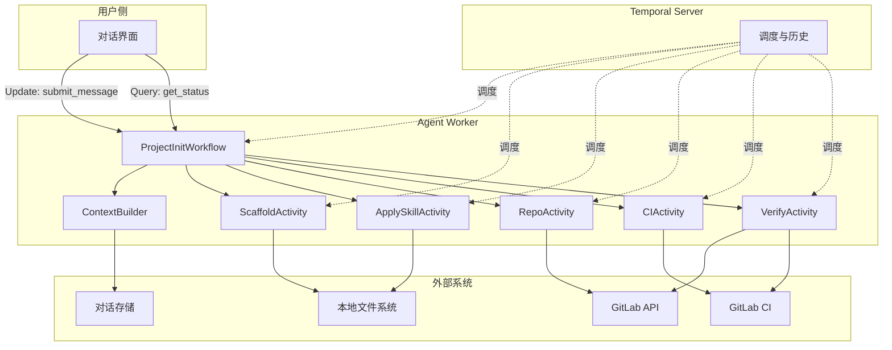
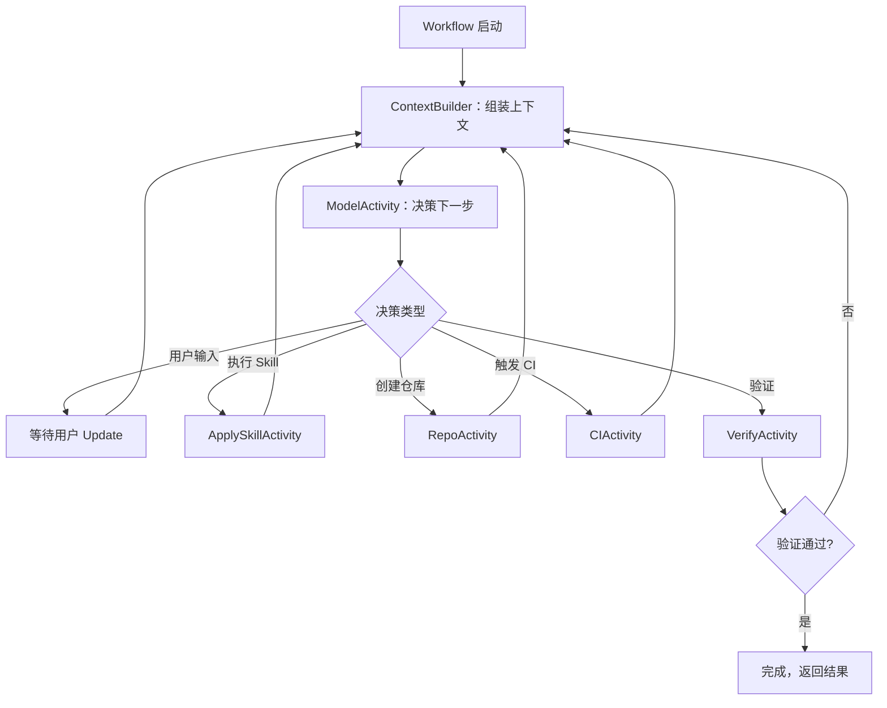

# 项目创建 Agent — 设计文档

## 1. 概述

### 1.1 目标

构建一个基于 Temporal 的持久化 Agent，用户通过多轮对话描述项目创建需求，Agent 理解意图、收集必要参数，自动完成 Golang 项目脚手架生成、GitLab 仓库初始化、GitLab CI 流水线配置与首跑验证。

### 1.2 技术栈

| 组件 | 选型 | 说明 |
|---|---|---|
| 编排引擎 | Temporal | Workflow 持久化、Activity 重试、Signal/Update |
| SDK | Temporal Go SDK | `go.temporal.io/sdk` 定义 Workflow 与 Activity |
| 语言 | Golang | 所有 Worker、Activity、Skill 逻辑 |
| 模板引擎 | 内嵌 Go template | 程序化渲染，无需外部模板工具 |
| 仓库平台 | GitLab | GitLab REST API v4 + git CLI |
| CI 平台 | GitLab CI | 生成 `.gitlab-ci.yml`，通过 Pipeline Triggers API 触发 |
| GitLab SDK | `github.com/xanzy/go-gitlab` | 封装 Projects、Pipelines、PipelineTriggers API |
| 密钥管理 | 环境变量 | 从环境变量读取 GitLab Token，不落盘 |
| 对话存储 | 本地文件系统（JSONL） | 第一版用文件，按 `agent_run_id` 索引 |


## 2. 核心概念

### 2.1 AgentDefinition

定义项目创建 Agent 的可复用能力配置，版本化，运行中不漂移。

```go
type AgentDefinition struct {
    DefinitionID     string   `json:"definition_id"`
    Version          string   `json:"version"`
    SupportedStacks  []string `json:"supported_stacks"`   // ["golang"]
    AvailableSkills  []string `json:"available_skills"`   // ["add_database", "add_auth", "add_logging"]
    DefaultCI        string   `json:"default_ci"`         // "gitlab_ci"
    RepoProvider     string   `json:"repo_provider"`      // "gitlab"
    SystemPrompt     string   `json:"system_prompt"`
}
```

### 2.2 AgentRun

一次具体项目创建任务。承载用户输入、执行状态和产物引用。

```go
type ProjectInitInput struct {
    ProjectName    string            `json:"project_name"`
    Description    string            `json:"description,omitempty"`
    TechStack      string            `json:"tech_stack"`       // "golang"
    SelectedSkills []string          `json:"selected_skills"`
    SkillConfigs   map[string]any    `json:"skill_configs"`
    RepoVisibility string            `json:"repo_visibility"`  // "private"
    ContextBudget  ContextBudget     `json:"context_budget"`
    State          *ProjectInitState `json:"state,omitempty"`  // Continue-As-New 携带
}

type ContextBudget struct {
    MaxTokens     int `json:"max_tokens"`      // 8000
    RecentTurns   int `json:"recent_turns"`    // 10
    SummaryTokens int `json:"summary_tokens"`  // 2000
}
```

### 2.3 Skill 契约

每个 Skill 是一个可复用的初始化能力单元。

| Skill ID | 功能 | 参数 |
|---|---|---|
| `add_database` | 添加数据库连接与 ORM 配置 | `database_type`（postgres/mysql/sqlite）、`orm`（gorm/sqlx） |
| `add_auth` | 添加认证与授权基础框架 | `auth_method`（jwt/session）、`token_ttl` |
| `add_logging` | 添加结构化日志 | `log_level`（debug/info/warn）、`format`（json/text）、`output`（console/file） |

```go
type SkillDefinition struct {
    SkillID             string         `json:"skill_id"`
    Name                string         `json:"name"`
    Description         string         `json:"description"`
    ParametersSchema    map[string]any `json:"parameters_schema"`
    SupportedTechStacks []string       `json:"supported_tech_stacks"`
}
```


## 3. 系统架构



Worker 同时注册 Workflow 和所有 Activity。Temporal Server 负责调度和持久化执行历史。Workflow 内部维护一个串行执行循环，每轮先调用 `ContextBuilder` 组装上下文，再调用模型决策，然后执行对应动作。


## 4. 数据模型

### 4.1 Workflow 内部状态

```go
type ProjectInitState struct {
    CurrentStep       string            `json:"current_step"`
    CompletedSteps    []string          `json:"completed_steps"`
    WorkspaceDir      string            `json:"workspace_dir"`
    RepoURL           string            `json:"repo_url"`
    RepoProjectID     int               `json:"repo_project_id"`
    PipelineID        string            `json:"pipeline_id"`
    Artifacts         map[string]string `json:"artifacts"`
    PendingUserInput  *string           `json:"pending_user_input,omitempty"`
    UserInputs        map[string]any    `json:"user_inputs"`
    Errors            []string          `json:"errors"`
    TurnCount         int               `json:"turn_count"`
}
```

### 4.2 消息模型

```go
type Message struct {
    Role         string   `json:"role"`          // "user" | "assistant" | "tool" | "system"
    Content      string   `json:"content"`
    Timestamp    string   `json:"timestamp"`
    TurnID       int      `json:"turn_id"`
    ArtifactRefs []string `json:"artifact_refs,omitempty"`
}

type Turn struct {
    TurnID         int       `json:"turn_id"`
    ModelDecision  string    `json:"model_decision"`
    ToolResults    []string  `json:"tool_results"`
    Timestamp      string    `json:"timestamp"`
}
```

### 4.3 Activity 输入输出

所有 Activity 的输入输出都是**小体积结构化数据**，大对象只传引用。Activity 参数应使用单个 struct 包裹，便于向后兼容。

```go
type ScaffoldInput struct {
    RunID       string `json:"run_id"`
    ProjectName string `json:"project_name"`
    TechStack   string `json:"tech_stack"`
    WorkspaceDir string `json:"workspace_dir"`
}

type ScaffoldOutput struct {
    WorkspaceDir  string `json:"workspace_dir"`
    FilesCreated  int    `json:"files_created"`
    ArtifactRef   string `json:"artifact_ref"`
}

type ApplySkillInput struct {
    RunID        string         `json:"run_id"`
    SkillID      string         `json:"skill_id"`
    Config       map[string]any `json:"config"`
    WorkspaceDir string         `json:"workspace_dir"`
}

type ApplySkillOutput struct {
    SkillID       string   `json:"skill_id"`
    FilesModified []string `json:"files_modified"`
    Success       bool     `json:"success"`
    Error         string   `json:"error,omitempty"`
}

type RepoOutput struct {
    RepoURL     string `json:"repo_url"`
    ProjectID   int    `json:"project_id"`
    DefaultBranch string `json:"default_branch"`
}

type CIOutput struct {
    PipelineID  string `json:"pipeline_id"`
    WorkflowFile string `json:"workflow_file"`
    Triggered   bool   `json:"triggered"`
}

type VerifyOutput struct {
    Passed bool            `json:"passed"`
    Checks []VerifyCheck   `json:"checks"`
}

type VerifyCheck struct {
    Name    string `json:"name"`
    Passed  bool   `json:"passed"`
    Detail  string `json:"detail"`
}
```

### 4.4 幂等键设计

每个写操作使用**确定性幂等键**，由 `workflow_run_id` + `step_name` 组成。Temporal Go SDK 通过 `activity.GetInfo(ctx)` 获取 `WorkflowExecution.RunID` 和 `ActivityID`。

```go
import (
    "go.temporal.io/sdk/activity"
)

func createRepoIdempotent(ctx context.Context, input RepoInput) (*RepoOutput, error) {
    info := activity.GetInfo(ctx)
    idempotencyKey := fmt.Sprintf("%s-create_repo", info.WorkflowExecution.RunID)

    // 先查询项目是否已存在
    existing, _, err := gitlabClient.Projects.GetProject(input.ProjectName, nil)
    if err == nil && existing != nil {
        return &RepoOutput{
            RepoURL:       existing.WebURL,
            ProjectID:     existing.ID,
            DefaultBranch: existing.DefaultBranch,
        }, nil
    }

    // 创建新项目
    project, _, err := gitlabClient.Projects.CreateProject(&gitlab.CreateProjectOptions{
        Name:                 gitlab.Ptr(input.ProjectName),
        Description:          gitlab.Ptr(input.Description),
        Visibility:           gitlab.Ptr(gitlab.PrivateVisibility),
        InitializeWithReadme: gitlab.Ptr(false),
    })
    if err != nil {
        return nil, fmt.Errorf("create gitlab project: %w", err)
    }

    return &RepoOutput{
        RepoURL:       project.WebURL,
        ProjectID:     project.ID,
        DefaultBranch: project.DefaultBranch,
    }, nil
}
```


## 5. Workflow 设计

### 5.1 整体流程



### 5.2 Workflow 定义

Workflow 使用 Signal 通道接收用户消息。Go SDK 中主 Workflow 方法从信号通道“接收”信号，并通过 Selector 处理。

```go
package workflows

import (
    "time"

    "go.temporal.io/sdk/workflow"
)

type ProjectInitWorkflow struct {
    state          ProjectInitState
    pendingMessage chan Message
    statusQuery    func() (ProjectInitState, error)
}

func (w *ProjectInitWorkflow) GetStatus(ctx workflow.Context) (ProjectInitState, error) {
    return w.state, nil
}

func ProjectInitWorkflowDefinition(ctx workflow.Context, input ProjectInitInput) (*ProjectInitResult, error) {
    w := &ProjectInitWorkflow{
        pendingMessage: make(chan Message, 10),
    }

    // 注册 Query
    err := workflow.SetQueryHandler(ctx, "get_status", func() (ProjectInitState, error) {
        return w.state, nil
    })
    if err != nil {
        return nil, err
    }

    // 恢复状态
    if input.State != nil {
        w.state = *input.State
    }

    // 注册 Update 处理用户消息
    err = workflow.SetUpdateHandler(ctx, "submit_message", func(ctx workflow.Context, msg Message) error {
        msg.TurnID = w.state.TurnCount + 1
        w.pendingMessage <- msg
        return nil
    })
    if err != nil {
        return nil, err
    }

    // 设置 Activity 选项
    ao := workflow.ActivityOptions{
        StartToCloseTimeout: 10 * time.Minute,
        RetryPolicy: &temporal.RetryPolicy{
            InitialInterval:    2 * time.Second,
            BackoffCoefficient: 2.0,
            MaximumInterval:    1 * time.Minute,
            MaximumAttempts:    3,
            NonRetryableErrorTypes: []string{"InvalidInput", "PermissionDenied"},
        },
    }
    ctx = workflow.WithActivityOptions(ctx, ao)

    // 主循环
    for {
        // 检查 Continue-As-New
        if workflow.GetInfo(ctx).GetContinueAsNewSuggested() {
            return nil, workflow.NewContinueAsNewError(ctx,
                ProjectInitWorkflowDefinition,
                ProjectInitInput{
                    ProjectName:    input.ProjectName,
                    TechStack:      input.TechStack,
                    SelectedSkills: input.SelectedSkills,
                    SkillConfigs:   input.SkillConfigs,
                    RepoVisibility: input.RepoVisibility,
                    ContextBudget:  input.ContextBudget,
                    State:          &w.state,
                },
            )
        }

        // 检查是否有待处理消息
        if w.state.PendingUserInput != nil {
            var msg Message
            workflow.Await(ctx, func() bool {
                return len(w.pendingMessage) > 0
            })
            msg = <-w.pendingMessage

            // 存入对话存储
            err = workflow.ExecuteActivity(ctx, StoreMessageActivity, StoreMessageInput{
                RunID:   workflow.GetInfo(ctx).WorkflowExecution.ID,
                Message: msg,
            }).Get(ctx, nil)
            if err != nil {
                return nil, err
            }

            w.state.PendingUserInput = nil
            w.state.TurnCount++
        }

        // 组装上下文
        var contextResult ContextOutput
        err = workflow.ExecuteActivity(ctx, BuildContext, BuildContextInput{
            RunID:       workflow.GetInfo(ctx).WorkflowExecution.ID,
            State:       w.state,
            Budget:      input.ContextBudget,
        }).Get(ctx, &contextResult)
        if err != nil {
            return nil, err
        }

        // 模型决策
        var decision ModelDecision
        err = workflow.ExecuteActivity(ctx, ModelDecide, ModelInput{
            RunID:   workflow.GetInfo(ctx).WorkflowExecution.ID,
            Context: contextResult.Context,
        }).Get(ctx, &decision)
        if err != nil {
            return nil, err
        }

        // 根据决策类型执行
        switch decision.Action {
        case "request_input":
            w.state.PendingUserInput = &decision.Question
            w.state.CurrentStep = "waiting_for_user"
            continue

        case "apply_skill":
            var result ApplySkillOutput
            err = workflow.ExecuteActivity(ctx, ApplySkill, ApplySkillInput{
                RunID:        workflow.GetInfo(ctx).WorkflowExecution.ID,
                SkillID:      decision.SkillID,
                Config:       decision.SkillConfig,
                WorkspaceDir: w.state.WorkspaceDir,
            }).Get(ctx, &result)
            if err != nil {
                return nil, err
            }
            w.state.CompletedSteps = append(w.state.CompletedSteps, "skill_"+decision.SkillID)

        case "scaffold":
            var result ScaffoldOutput
            err = workflow.ExecuteActivity(ctx, ScaffoldProject, ScaffoldInput{
                RunID:        workflow.GetInfo(ctx).WorkflowExecution.ID,
                ProjectName:  input.ProjectName,
                TechStack:    input.TechStack,
                WorkspaceDir: w.state.WorkspaceDir,
            }).Get(ctx, &result)
            if err != nil {
                return nil, err
            }
            w.state.WorkspaceDir = result.WorkspaceDir
            w.state.CompletedSteps = append(w.state.CompletedSteps, "scaffold")

        case "create_repo":
            var result RepoOutput
            err = workflow.ExecuteActivity(ctx, CreateAndPushRepo, RepoInput{
                RunID:        workflow.GetInfo(ctx).WorkflowExecution.ID,
                ProjectName:  input.ProjectName,
                Description:  input.Description,
                WorkspaceDir: w.state.WorkspaceDir,
                Visibility:   input.RepoVisibility,
            }).Get(ctx, &result)
            if err != nil {
                return nil, err
            }
            w.state.RepoURL = result.RepoURL
            w.state.RepoProjectID = result.ProjectID
            w.state.CompletedSteps = append(w.state.CompletedSteps, "repo")

        case "trigger_ci":
            var result CIOutput
            err = workflow.ExecuteActivity(ctx, TriggerCI, CIInput{
                RunID:      workflow.GetInfo(ctx).WorkflowExecution.ID,
                ProjectID:  w.state.RepoProjectID,
                TechStack:  input.TechStack,
            }).Get(ctx, &result)
            if err != nil {
                return nil, err
            }
            w.state.PipelineID = result.PipelineID
            w.state.CompletedSteps = append(w.state.CompletedSteps, "ci")

        case "verify":
            var result VerifyOutput
            err = workflow.ExecuteActivity(ctx, VerifyProject, VerifyInput{
                RunID:        workflow.GetInfo(ctx).WorkflowExecution.ID,
                ProjectID:    w.state.RepoProjectID,
                PipelineID:   w.state.PipelineID,
                WorkspaceDir: w.state.WorkspaceDir,
            }).Get(ctx, &result)
            if err != nil {
                return nil, err
            }
            if result.Passed {
                return &ProjectInitResult{
                    Status:   "completed",
                    RepoURL:  w.state.RepoURL,
                    Checks:   result.Checks,
                }, nil
            }
            // 验证失败，记录错误，让模型重新决策
            w.state.Errors = append(w.state.Errors, formatChecks(result.Checks))

        case "propose_completion":
            // 模型提出完成，执行验证
            var result VerifyOutput
            err = workflow.ExecuteActivity(ctx, VerifyProject, VerifyInput{
                RunID:        workflow.GetInfo(ctx).WorkflowExecution.ID,
                ProjectID:    w.state.RepoProjectID,
                PipelineID:   w.state.PipelineID,
                WorkspaceDir: w.state.WorkspaceDir,
            }).Get(ctx, &result)
            if err != nil {
                return nil, err
            }
            if result.Passed {
                return &ProjectInitResult{
                    Status:  "completed",
                    RepoURL: w.state.RepoURL,
                    Checks:  result.Checks,
                }, nil
            }
            w.state.Errors = append(w.state.Errors, formatChecks(result.Checks))
        }
    }
}
```

### 5.3 Continue-As-New

当执行历史接近限制时，触发 Continue-As-New，携带当前状态开启新一轮执行。业务 `agent_run_id` 保持不变。

```go
if workflow.GetInfo(ctx).GetContinueAsNewSuggested() {
    return nil, workflow.NewContinueAsNewError(ctx,
        ProjectInitWorkflowDefinition,
        ProjectInitInput{
            ProjectName:    input.ProjectName,
            TechStack:      input.TechStack,
            SelectedSkills: input.SelectedSkills,
            SkillConfigs:   input.SkillConfigs,
            RepoVisibility: input.RepoVisibility,
            ContextBudget:  input.ContextBudget,
            State:          &w.state,
        },
    )
}
```

### 5.4 人工输入

使用 `SetUpdateHandler` 处理用户消息，`SetQueryHandler` 提供状态查询。Update 提供同步请求-响应能力，Query 用于前端获取当前状态。

```go
// 注册 Update handler：接收用户自然语言消息
err := workflow.SetUpdateHandler(ctx, "submit_message",
    func(ctx workflow.Context, msg Message) error {
        msg.TurnID = w.state.TurnCount + 1
        w.pendingMessage <- msg
        return nil
    })

// 注册 Query handler：前端查询当前状态
err = workflow.SetQueryHandler(ctx, "get_status",
    func() (ProjectInitState, error) {
        return w.state, nil
    })
```

客户端发送消息：

```go
// 发送用户消息
err := workflowClient.UpdateWorkflow(ctx, workflowID, "",
    "submit_message", Message{
        Role:    "user",
        Content: "帮我创建一个 Golang 项目，需要数据库和日志功能",
    })
```


## 6. 多轮对话与上下文压缩

### 6.1 对话存储

对话历史不放在 Workflow 状态中，而是存储在外部，按 `agent_run_id` 索引。Workflow 只保存紧凑状态和对话引用。

```go
type ConversationStore struct {
    baseDir string
}

func (s *ConversationStore) Append(runID string, msg Message) error {
    path := filepath.Join(s.baseDir, runID+".jsonl")
    f, err := os.OpenFile(path, os.O_APPEND|os.O_CREATE|os.O_WRONLY, 0644)
    if err != nil {
        return err
    }
    defer f.Close()

    data, _ := json.Marshal(msg)
    _, err = f.Write(append(data, '\n'))
    return err
}

func (s *ConversationStore) ReadRecent(runID string, n int) ([]Message, error) {
    path := filepath.Join(s.baseDir, runID+".jsonl")
    f, err := os.Open(path)
    if err != nil {
        if os.IsNotExist(err) {
            return nil, nil
        }
        return nil, err
    }
    defer f.Close()

    var msgs []Message
    scanner := bufio.NewScanner(f)
    for scanner.Scan() {
        var m Message
        if err := json.Unmarshal(scanner.Bytes(), &m); err != nil {
            continue
        }
        msgs = append(msgs, m)
    }

    if len(msgs) > n {
        msgs = msgs[len(msgs)-n:]
    }
    return msgs, nil
}
```

### 6.2 ContextBuilder

`ContextBuilder` 按 token 预算组装上下文。固定层、状态层、工作记忆层、检索层、引用层分级裁剪。

```go
type BuildContextInput struct {
    RunID  string            `json:"run_id"`
    State  ProjectInitState  `json:"state"`
    Budget ContextBudget     `json:"budget"`
}

type ContextOutput struct {
    Context string `json:"context"`
}

func BuildContextActivity(ctx context.Context, input BuildContextInput) (*ContextOutput, error) {
    var parts []string

    // 1. 固定层：Agent 定义、动作协议
    parts = append(parts, formatSystemPrompt())

    // 2. 状态层：当前步骤、已完成步骤、待处理决策、预算
    stateJSON, _ := json.Marshal(input.State)
    parts = append(parts, "当前状态：\n"+string(stateJSON))

    // 3. 工作记忆层：最近 N 轮对话
    store := &ConversationStore{baseDir: "/data/conversations"}
    recent, _ := store.ReadRecent(input.RunID, input.Budget.RecentTurns)
    for _, msg := range recent {
        parts = append(parts, fmt.Sprintf("[%s] %s", msg.Role, msg.Content))
    }

    // 4. 检索层：根据当前状态按需检索相关材料
    // 例如：如果用户提到"数据库"，检索数据库配置文档

    // 5. 引用层：大对象只给引用
    for key, ref := range input.State.Artifacts {
        parts = append(parts, fmt.Sprintf("产物引用 %s: %s", key, ref))
    }

    // Token 预算裁剪
    context := strings.Join(parts, "\n\n")
    context = truncateToTokenBudget(context, input.Budget.MaxTokens)

    return &ContextOutput{Context: context}, nil
}

func truncateToTokenBudget(text string, maxTokens int) string {
    // 粗略估算：1 token ≈ 4 字符
    maxChars := maxTokens * 4
    if len(text) <= maxChars {
        return text
    }
    return text[:maxChars]
}
```

### 6.3 上下文压缩策略

当对话轮次超过阈值时，对早期对话进行摘要，但**授权、预算、完成条件、安全约束必须始终保留**。

```go
type CompressInput struct {
    RunID       string `json:"run_id"`
    MaxSummaryTokens int `json:"max_summary_tokens"`
}

func CompressContextActivity(ctx context.Context, input CompressInput) error {
    store := &ConversationStore{baseDir: "/data/conversations"}
    allMsgs, _ := store.ReadAll(input.RunID)

    if len(allMsgs) <= 20 {
        return nil
    }

    // 保留最近 10 条不压缩
    toCompress := allMsgs[:len(allMsgs)-10]
    toKeep := allMsgs[len(allMsgs)-10:]

    // 用模型生成摘要
    summary := generateSummary(toCompress, input.MaxSummaryTokens)

    // 重写对话存储：摘要 + 最近对话
    store.Rewrite(input.RunID, append([]Message{{
        Role:    "system",
        Content: "历史对话摘要：" + summary,
    }}, toKeep...))

    return nil
}
```

### 6.4 上下文传播

Temporal Go SDK 提供 `ContextPropagator` 接口，用于在 Client → Workflow → Activity 之间传递自定义键值数据，无需在每个函数签名中显式传递。

```go
type agentContextPropagator struct{}

func (p *agentContextPropagator) Inject(ctx context.Context, writer workflow.HeaderWriter) error {
    runID, _ := ctx.Value(agentRunIDKey{}).(string)
    if runID != "" {
        payload, _ := converter.GetDefaultDataConverter().ToPayload(runID)
        writer.Set("agent-run-id", payload)
    }
    return nil
}

func (p *agentContextPropagator) Extract(ctx context.Context, reader workflow.HeaderReader) (context.Context, error) {
    if payload, err := reader.Get("agent-run-id"); err == nil {
        var runID string
        payload.Get(&runID)
        ctx = context.WithValue(ctx, agentRunIDKey{}, runID)
    }
    return ctx, nil
}

func (p *agentContextPropagator) InjectFromWorkflow(ctx workflow.Context, writer workflow.HeaderWriter) error {
    return nil
}

func (p *agentContextPropagator) ExtractToWorkflow(ctx workflow.Context, reader workflow.HeaderReader) (workflow.Context, error) {
    return ctx, nil
}
```


## 7. Activity 设计

### 7.1 ScaffoldActivity

根据 Golang 技术栈生成项目骨架。Activity 定义可以是可导出的函数或 struct 方法。

```go
type ScaffoldActivity struct{}

func (a *ScaffoldActivity) Scaffold(ctx context.Context, input ScaffoldInput) (*ScaffoldOutput, error) {
    // 幂等检查：如果标记文件已存在，直接返回
    markerPath := filepath.Join(input.WorkspaceDir, ".scaffold_complete")
    if _, err := os.Stat(markerPath); err == nil {
        return &ScaffoldOutput{
            WorkspaceDir: input.WorkspaceDir,
            ArtifactRef:  fmt.Sprintf("artifacts/%s/scaffold_manifest.json", input.RunID),
        }, nil
    }

    // 创建项目目录结构
    dirs := []string{
        "cmd/" + input.ProjectName,
        "internal/",
        "pkg/",
        "configs/",
        "scripts/",
        "test/",
    }
    for _, dir := range dirs {
        os.MkdirAll(filepath.Join(input.WorkspaceDir, dir), 0755)
    }

    // 生成 go.mod
    goModContent := fmt.Sprintf("module %s\n\ngo 1.22\n", input.ProjectName)
    os.WriteFile(filepath.Join(input.WorkspaceDir, "go.mod"), []byte(goModContent), 0644)

    // 生成 main.go
    mainContent := fmt.Sprintf(`package main

import (
    "fmt"
    "log"
)

func main() {
    fmt.Println("Project %s initialized")
    log.Println("ready")
}
`, input.ProjectName)
    os.WriteFile(filepath.Join(input.WorkspaceDir, "cmd", input.ProjectName, "main.go"),
        []byte(mainContent), 0644)

    // 生成 .gitignore
    gitignoreContent := `# Binaries
*.exe
*.exe~
*.dll
*.so
*.dylib

# Test binary
*.test

# Output
/bin/
/dist/

# IDE
.idea/
.vscode/

# Environment
.env
*.pem
*.key
`
    os.WriteFile(filepath.Join(input.WorkspaceDir, ".gitignore"),
        []byte(gitignoreContent), 0644)

    // 写入完成标记
    os.WriteFile(markerPath, []byte(time.Now().Format(time.RFC3339)), 0644)

    return &ScaffoldOutput{
        WorkspaceDir: input.WorkspaceDir,
        FilesCreated: len(dirs) + 4,
        ArtifactRef:  fmt.Sprintf("artifacts/%s/scaffold_manifest.json", input.RunID),
    }, nil
}
```

**幂等设计**：如果 `workspace_dir` 已存在且包含 `.scaffold_complete` 标记文件，直接返回已有结果。

### 7.2 ApplySkillActivity

执行一个 Skill 的初始化逻辑。Skill 目录下写入 `.skill_applied_{skill_id}` 标记文件，重试时检查标记，跳过已完成的 Skill。

```go
type ApplySkillActivity struct{}

func (a *ApplySkillActivity) Apply(ctx context.Context, input ApplySkillInput) (*ApplySkillOutput, error) {
    // 幂等检查
    markerPath := filepath.Join(input.WorkspaceDir, ".skill_applied_"+input.SkillID)
    if _, err := os.Stat(markerPath); err == nil {
        return &ApplySkillOutput{
            SkillID: input.SkillID,
            Success: true,
        }, nil
    }

    skill, ok := skillRegistry[input.SkillID]
    if !ok {
        return nil, temporal.NewNonRetryableApplicationError(
            fmt.Sprintf("unknown skill: %s", input.SkillID),
            "InvalidInput", nil)
    }

    // 参数校验
    if err := validateParams(input.Config, skill.ParametersSchema); err != nil {
        return nil, temporal.NewNonRetryableApplicationError(
            fmt.Sprintf("invalid params: %v", err),
            "InvalidInput", nil)
    }

    // 渲染并写入文件
    renderedFiles, err := renderSkillTemplates(skill, input.Config)
    if err != nil {
        return nil, fmt.Errorf("render templates: %w", err)
    }

    var modified []string
    for filePath, content := range renderedFiles {
        target := filepath.Join(input.WorkspaceDir, filePath)
        os.MkdirAll(filepath.Dir(target), 0755)
        if err := os.WriteFile(target, []byte(content), 0644); err != nil {
            return nil, fmt.Errorf("write %s: %w", filePath, err)
        }
        modified = append(modified, filePath)
    }

    // 执行 post hook（如 go mod tidy）
    if skill.PostHook != "" {
        if err := runPostHook(input.WorkspaceDir, skill.PostHook); err != nil {
            return nil, fmt.Errorf("post hook: %w", err)
        }
    }

    // 写入完成标记
    os.WriteFile(markerPath, []byte(time.Now().Format(time.RFC3339)), 0644)

    return &ApplySkillOutput{
        SkillID:       input.SkillID,
        FilesModified: modified,
        Success:       true,
    }, nil
}
```

### 7.3 RepoActivity

创建 GitLab 项目并推送代码。使用 `go-gitlab` 库操作 Projects API。

```go
type RepoActivity struct{}

func (a *RepoActivity) CreateAndPush(ctx context.Context, input RepoInput) (*RepoOutput, error) {
    info := activity.GetInfo(ctx)
    idempotencyKey := fmt.Sprintf("%s-create_repo", info.WorkflowExecution.RunID)

    // 幂等检查：项目是否已存在
    existing, _, err := gitlabClient.Projects.GetProject(input.ProjectName, nil)
    if err == nil && existing != nil {
        return &RepoOutput{
            RepoURL:       existing.WebURL,
            ProjectID:     existing.ID,
            DefaultBranch: existing.DefaultBranch,
        }, nil
    }

    // 创建 GitLab 项目
    project, _, err := gitlabClient.Projects.CreateProject(&gitlab.CreateProjectOptions{
        Name:                 gitlab.Ptr(input.ProjectName),
        Description:          gitlab.Ptr(input.Description),
        Visibility:           gitlab.Ptr(gitlab.PrivateVisibility),
        InitializeWithReadme: gitlab.Ptr(false),
    })
    if err != nil {
        return nil, fmt.Errorf("create gitlab project: %w", err)
    }

    // 初始化 git 并推送
    commands := [][]string{
        {"git", "init"},
        {"git", "checkout", "-b", "main"},
        {"git", "add", "."},
        {"git", "commit", "-m", fmt.Sprintf("Initial commit [%s]", info.WorkflowExecution.RunID)},
        {"git", "remote", "add", "origin",
            fmt.Sprintf("https://oauth2:%s@gitlab.com/%s.git", gitlabToken, project.PathWithNamespace)},
        {"git", "push", "-u", "origin", "main"},
    }

    for _, cmd := range commands {
        if err := runGit(input.WorkspaceDir, cmd...); err != nil {
            return nil, fmt.Errorf("git %s: %w", cmd[1], err)
        }
    }

    return &RepoOutput{
        RepoURL:       project.WebURL,
        ProjectID:     project.ID,
        DefaultBranch: "main",
    }, nil
}
```

**幂等设计**：先查项目是否存在，存在则跳过创建。推送前检查远程是否已有 commit。

**“结果未知”处理**：如果推送后 Worker 崩溃，重试时先执行 `git ls-remote` 检查远程状态。

### 7.4 CIActivity

生成 `.gitlab-ci.yml`，推送后通过 Pipeline Triggers API 触发流水线。

```go
type CIActivity struct{}

func (a *CIActivity) TriggerCI(ctx context.Context, input CIInput) (*CIOutput, error) {
    // 生成 .gitlab-ci.yml
    ciContent := generateGitLabCI(input.TechStack)
    ciPath := filepath.Join(input.WorkspaceDir, ".gitlab-ci.yml")
    os.WriteFile(ciPath, []byte(ciContent), 0644)

    // 推送 CI 配置
    if err := runGit(input.WorkspaceDir, "add", ".gitlab-ci.yml"); err != nil {
        return nil, err
    }
    if err := runGit(input.WorkspaceDir, "commit", "-m", "Add GitLab CI configuration"); err != nil {
        return nil, err
    }
    if err := runGit(input.WorkspaceDir, "push", "origin", "main"); err != nil {
        return nil, err
    }

    // 触发 Pipeline
    pipeline, _, err := gitlabClient.PipelineTriggers.RunPipelineTrigger(
        input.ProjectID,
        &gitlab.RunPipelineTriggerOptions{
            Ref: gitlab.Ptr("main"),
            Variables: map[string]string{
                "TRIGGER_SOURCE": "agent",
            },
        },
    )
    if err != nil {
        return nil, fmt.Errorf("trigger pipeline: %w", err)
    }

    return &CIOutput{
        PipelineID:   fmt.Sprintf("%d", pipeline.ID),
        WorkflowFile: ".gitlab-ci.yml",
        Triggered:    true,
    }, nil
}

func generateGitLabCI(techStack string) string {
    return `stages:
  - build
  - test
  - security

variables:
  GO_VERSION: "1.22"

build:
  stage: build
  image: golang:${GO_VERSION}
  script:
    - go mod download
    - go build ./...
  artifacts:
    paths:
      - bin/

test:
  stage: test
  image: golang:${GO_VERSION}
  script:
    - go test ./... -v -race -coverprofile=coverage.out
  coverage: '/total:\s+\(statements\)\s+(\d+.\d+)%/'
  artifacts:
    reports:
      coverage_report:
        coverage_format: cobertura
        path: coverage.xml

security:
  stage: security
  image: golang:${GO_VERSION}
  script:
    - go install golang.org/x/vuln/cmd/govulncheck@latest
    - govulncheck ./...
  allow_failure: false
`
}
```

**幂等设计**：CI 文件推送使用 git 的幂等性（内容相同则不产生新 commit）。Pipeline 触发重复执行只产生多个 pipeline，不影响正确性，Verify 只检查最新的 pipeline。

### 7.5 VerifyActivity

独立验证所有初始化结果，不信任之前的“成功”声明。

```go
type VerifyActivity struct{}

func (a *VerifyActivity) Verify(ctx context.Context, input VerifyInput) (*VerifyOutput, error) {
    var checks []VerifyCheck

    // 1. 项目可访问
    project, _, err := gitlabClient.Projects.GetProject(input.ProjectID, nil)
    checks = append(checks, VerifyCheck{
        Name:   "project_accessible",
        Passed: err == nil && project != nil,
        Detail: fmt.Sprintf("err=%v", err),
    })

    // 2. 代码已推送
    if project != nil {
        _, _, err := gitlabClient.Commits.GetCommit(project.ID, "main", nil)
        checks = append(checks, VerifyCheck{
            Name:   "code_pushed",
            Passed: err == nil,
        })
    }

    // 3. Pipeline 完成且成功
    if input.PipelineID != "" {
        pid, _ := strconv.Atoi(input.PipelineID)
        pipeline, _, err := gitlabClient.Pipelines.GetPipeline(input.ProjectID, pid)
        if err == nil && pipeline != nil {
            passed := pipeline.Status == "success"
            checks = append(checks, VerifyCheck{
                Name:   "ci_passed",
                Passed: passed,
                Detail: fmt.Sprintf("status=%s", pipeline.Status),
            })
        } else {
            checks = append(checks, VerifyCheck{
                Name:   "ci_passed",
                Passed: false,
                Detail: fmt.Sprintf("err=%v", err),
            })
        }
    }

    // 4. 关键文件存在
    for _, f := range []string{"go.mod", ".gitignore", ".gitlab-ci.yml", "README.md"} {
        _, err := os.Stat(filepath.Join(input.WorkspaceDir, f))
        checks = append(checks, VerifyCheck{
            Name:   "file_" + f,
            Passed: err == nil,
        })
    }

    // 5. 密钥未泄漏
    gitignore, _ := os.ReadFile(filepath.Join(input.WorkspaceDir, ".gitignore"))
    checks = append(checks, VerifyCheck{
        Name:   "secrets_ignored",
        Passed: strings.Contains(string(gitignore), ".env"),
    })

    allPassed := true
    for _, c := range checks {
        if !c.Passed {
            allPassed = false
        }
    }

    return &VerifyOutput{
        Passed: allPassed,
        Checks: checks,
    }, nil
}
```


## 8. 错误处理

### 8.1 错误分类

| 类型 | 示例 | 处理方式 |
|---|---|---|
| 基础设施故障 | 网络超时、API 限流、Worker 崩溃 | Activity 自动重试，指数退避 |
| 业务失败 | 项目名已存在、CI 编译失败、模板不兼容 | 返回 `NonRetryableApplicationError`，Workflow 重新决策 |
| 永久失败 | 无效输入、权限不足 | 不重试，直接失败并返回详情 |

### 8.2 Activity 重试策略

```go
ao := workflow.ActivityOptions{
    StartToCloseTimeout: 10 * time.Minute,
    RetryPolicy: &temporal.RetryPolicy{
        InitialInterval:        2 * time.Second,
        BackoffCoefficient:     2.0,
        MaximumInterval:        1 * time.Minute,
        MaximumAttempts:        3,
        NonRetryableErrorTypes: []string{"InvalidInput", "PermissionDenied"},
    },
}
ctx = workflow.WithActivityOptions(ctx, ao)
```

`StartToCloseTimeout` 是 Activity 执行语义唯一必须设置的值。

### 8.3 “结果未知”处理

对于写操作，重试前先查询外部状态。

```go
func createRepoIdempotent(ctx context.Context, input RepoInput) (*RepoOutput, error) {
    // 先查项目是否已存在
    existing, _, err := gitlabClient.Projects.GetProject(input.ProjectName, nil)
    if err == nil && existing != nil {
        return &RepoOutput{
            RepoURL:       existing.WebURL,
            ProjectID:     existing.ID,
            DefaultBranch: existing.DefaultBranch,
        }, nil
    }
    // ... 创建新项目
}
```

推送操作同理，重试前先 `git fetch` + `git status` 检查远程与本地差异。


## 9. 安全设计

### 9.1 密钥管理

- GitLab Token 从**环境变量** `GITLAB_TOKEN` 读取
- **不写入** Workflow 历史、日志、模板文件、CI 配置
- `.gitignore` 强制包含 `.env`、`*.pem`、`*.key`
- GitLab CI 中需要的密钥通过 GitLab CI/CD Variables 注入

### 9.2 权限最小化

- GitLab Token 只包含 `api` 和 `write_repository` scope
- 不使用 `admin` 权限
- 临时目录访问限制在 `/tmp/agent-runs/` 下

### 9.3 审计日志

所有关键操作写入结构化日志。

```go
type AuditLog struct {
    Timestamp   string `json:"timestamp"`
    AgentRunID  string `json:"agent_run_id"`
    Step        string `json:"step"`
    Action      string `json:"action"`
    ParamsHash  string `json:"params_hash"`
    Result      string `json:"result"`
    DurationMs  int64  `json:"duration_ms"`
}
```


## 10. 可观测性

### 10.1 Temporal 原生能力

- **Workflow 执行历史**：每一步 Activity 调用、输入输出、重试记录在 Temporal UI 可见
- **Workflow Query**：前端通过 `get_status` Query 获取实时进度
- **Activity 心跳**：长耗时 Activity 设置心跳

### 10.2 关键指标

| 指标 | 说明 |
|---|---|
| `workflow_success_count` | 成功完成的项目创建数 |
| `workflow_failed_count` | 失败数，按失败步骤分类 |
| `activity_retry_count` | Activity 重试次数 |
| `verify_failure_count` | 验证失败次数，按 check 类型分类 |
| `total_duration_ms` | 端到端耗时 |
| `turn_count` | 对话轮次统计 |


## 11. 目录结构

```
project-init-agent/
├── cmd/
│   └── worker/
│       └── main.go              # Worker 启动入口
├── workflows/
│   └── project_init.go          # ProjectInitWorkflow
├── activities/
│   ├── scaffold.go              # ScaffoldActivity
│   ├── apply_skill.go           # ApplySkillActivity
│   ├── repo.go                  # RepoActivity
│   ├── ci.go                    # CIActivity
│   ├── verify.go                # VerifyActivity
│   ├── context_builder.go       # ContextBuilder + Compress
│   └── conversation_store.go    # 对话存储
├── models/
│   ├── workflow_models.go       # WorkflowInput, State, Message, Turn
│   └── activity_models.go       # Activity Input/Output structs
├── skills/
│   ├── add_database/
│   │   ├── skill.json           # 契约定义
│   │   └── templates/           # Go template 文件
│   ├── add_auth/
│   └── add_logging/
├── templates/
│   └── golang/                  # Golang 基础项目模板
├── propagator/
│   └── agent_context.go         # ContextPropagator 实现
├── starter/
│   └── main.go                  # 客户端入口
└── config/
    └── config.go                # 环境变量读取
```


## 12. 实施计划

| 阶段 | 内容 | 验收标准 |
|---|---|---|
| **Week 1** | Worker 搭建、Workflow 骨架、ScaffoldActivity | 能创建 Golang 项目骨架 |
| **Week 2** | ContextBuilder + 对话存储 + ApplySkillActivity | 多轮对话能正确组装上下文，三个 Skill 能修改文件 |
| **Week 3** | RepoActivity + CIActivity | 能创建 GitLab 项目、推送、触发 Pipeline |
| **Week 4** | VerifyActivity + 上下文压缩 + 幂等验证 | 杀 Worker 后重启能接续，写操作不重复，压缩正确触发 |
| **Week 5** | Update/Query 交互 + ContextPropagator | 用户能通过对话界面提交消息，状态实时可见 |
| **Week 6** | 端到端测试 + 文档 | 完整走通一个项目创建流程 |


## 13. 核心验收场景

1. **多轮对话正常流程**：用户说“帮我创建一个 Golang 项目” → Agent 询问项目名 → 用户回复 → Agent 询问 Skill 选择 → 用户选择 → Agent 完成创建
2. **Worker 崩溃恢复**：在 ApplySkill 执行中杀掉 Worker，重启后从断点继续，对话历史不丢失
3. **写操作幂等**：在 RepoActivity 执行中杀掉 Worker，重启后不重复创建 GitLab 项目
4. **上下文压缩**：对话超过 20 轮后，自动触发摘要压缩，早期对话被摘要替代
5. **CI 失败反馈**：Pipeline 编译失败 → Verify 捕获 → 返回失败详情，Agent 向用户报告
6. **密钥安全**：检查日志、Workflow 历史、生成的代码中无 GitLab Token 泄漏
7. **Continue-As-New**：长时间任务正确触发 Continue-As-New，对话历史和状态不丢失
8. **并发消息处理**：用户快速发送多条消息，Signal 通道不阻塞，消息按顺序处理